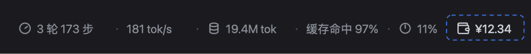
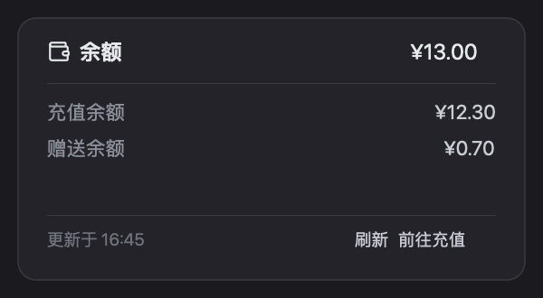

# DeepSeek Harness 账户余额徽章

在输入框下方的状态栏右侧实时显示 DeepSeek 账户余额，点一下展开详情面板 —— 与旁边官方的「轮/步」「token 用量」「上下文占用」三项交互完全一致。





> 上图为示意图，数字为示例值。

## 功能

- **实时余额**：挂载时拉取一次，之后每 60 秒刷新；页面切回前台立刻刷新；打开面板时若距上次超过 15 秒会补一次
- **点击展开详情**：合计、充值余额 / 赠送余额、更新时间、手动刷新、前往充值（跳开放平台），Esc 或点外部关闭
- **多币种**：CNY 显示 `¥`、USD 显示 `$`，多币种用 ` + ` 连接；格式化规则与官方账户页一致（千分位、两位小数向下取整、`<¥0.01`）
- **状态完整**：未登录显示「登录后查看余额」，接口失败显示「余额不可用」并给出原因，不会把整行状态栏搞崩
- **跟随主题**：全部使用 DSH 主题 token（`--dsw-alias-*`），明暗主题、字号缩放自动适配
- **中英文**：随界面语言切换，不依赖运行时可用的语言包

## 安装

要求：DSH Desktop（Web UI），并且已在「设置 → 账户」登录。

本仓库是一个 DSH bundle 插件（Host 半边 + Client 半边），安装方式与其他本地 bundle 一致：

```bash
git clone https://github.com/MR-MaoJiu/dsh-account-balance.git
```

然后在 Harness 左侧「插件 → 安装」中填入该目录的**绝对路径**（或者让 Agent 调用 `plugin_manager install_bundle`，target 指向该目录）。装完刷新页面，状态栏右侧就会出现余额徽章。

卸载：「插件」页停用或移除 `@local/account-balance` 即可，不会留下残余配置。

## 工作原理

| 方面 | 实现 |
|---|---|
| 位置 | 注册到 `conversation.composer.dock`（输入框下方的 ambient 区域），`id: account-balance`、`order: 2` |
| 数据 | Client 侧 `ctx.remote.account.getBalance({ version, locale, timezoneOffsetSeconds })`，即 Host 的 `deepseekAccount` 服务 |
| 凭据 | 不申请额外 API Key，也不读本地凭据文件；沿用 Harness 已登录的账户通道 |
| 刷新 | 定时 60s + `visibilitychange` + 打开面板按需刷新；**没有**用 `account.watch()` 长连接（它需要额外授权） |
| 浮层 | `createPortal` 到 `document.body` 并向上定位、带视口 clamp，避免被 docked composer 裁剪 |

`client.version` 优先上报 Harness 自身的 release 版本（`window.__DSH_BOOT__.release.version`），取不到才退回插件版本，避免冒充客户端版本。

## 自定义

| 想改什么 | 改哪里 |
|---|---|
| 刷新间隔 | `client.js` 的 `REFRESH_INTERVAL_MS` |
| 贴到最右边缘 | `.dsb_anchor` 规则里加 `margin-left:auto`；注意 dock 是 `justify-content:center`，这会把左边两个 pill 一起推到最左 |
| 图标 | `client.js` 的 `icon()`：24 网格、`stroke-width: 2`，14px 显示时约 1.17px，与相邻图标视觉重量一致 |
| 包名 / 插件 id | `package.json` 的 `name`、`cordis.patch.yml` 的 `name`、`client.js` 里 `load({ id })` 三处同步修改后重新安装 |

## 已知限制

- 安装或更新后需要刷新页面：Client bundle 在页面加载时装配
- 余额数据本身在开放平台侧有缓存，「实时」的实际精度是最慢 60 秒
- 未实现余额变动推送（原因见上）
- 只在 DSH Desktop / Web 上验证过；CLI 没有可用的状态栏插槽，本插件不会渲染

## 开发

没有构建步骤，`client.js` 就是最终产物，直接改即可：

```bash
node --check client.js index.js
node -e "JSON.parse(require('fs').readFileSync('package.json','utf8'))"
```

改完刷新页面（或重装）即可看到效果。文件职责：

| 文件 | 作用 |
|---|---|
| `client.js` | 徽章 + 详情面板全部实现（Client 半边） |
| `index.js` | Host 半边，当前为空实现 |
| `cordis.patch.yml` | 向 profile 组合插入本插件 |
| `locale/*.json` | 插件列表里的标题与描述 |
| `icon.svg` | 插件列表图标 |

## License

MIT © MR-MaoJiu

---

## English

A DeepSeek Harness bundle plugin that shows your DeepSeek account balance in the composer status row (next to the token usage / context pills) and expands a detail panel on click.

- Live balance: fetched on mount, refreshed every 60s while visible, and on demand when the panel opens
- Works with the already signed-in account channel (`ctx.remote.account`) — no API key, no credential files
- Theme-token styling, localized (zh / en), multi-currency formatting identical to the official account page

Install: clone the repo, then install the directory as a bundle from Harness → Plugins (or `plugin_manager install_bundle`), and reload the page.
